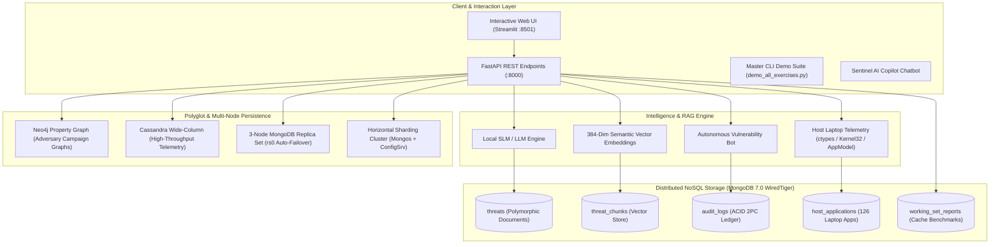
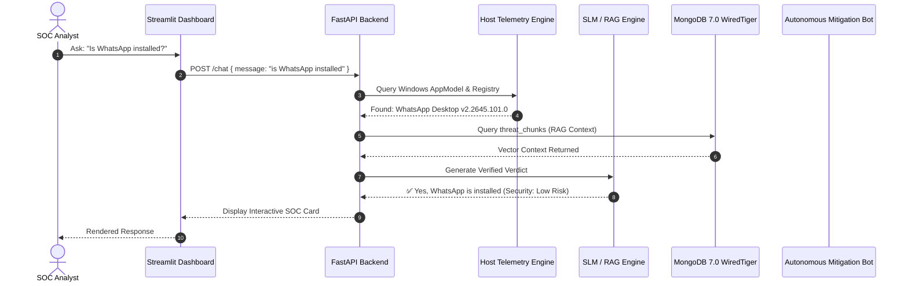

# Distributed NoSQL Databases & Cyber Threat Intelligence AI Platform

[](https://hub.docker.com/r/shashankreddy30/mongodb-nosql-labs-and-capstone)
[](https://hub.docker.com/r/shashankreddy30/threat-intel-app)
[](https://www.mongodb.com/)
[](https://www.python.org/)
[](https://www.docker.com/)
[](https://fastapi.tiangolo.com/)
[](https://streamlit.io/)
[]()

> **Author:** G. Shashank Reddy (Chintan)  
> **Student ID / USN:** 24BTRCL079  
> **Programme:** B.Tech CSE (AIML), Section B  
> **Curriculum:** Distributed NoSQL Databases using MongoDB (7.0) & AI Systems  

---

## 📌 Executive Summary

This repository provides an enterprise-grade, comprehensive implementation of all **18 Distributed NoSQL Laboratory Experiments** alongside the **Cyber Threat Intelligence (CTI) AI Capstone Platform**.

It covers core database internals, data modeling, aggregation frameworks, high availability, clustering, sharding, enterprise security, multi-tenancy, polyglot persistence, vector search (RAG), and a full-stack containerized LLM platform.

All modules are packaged into a single unified Docker image on Docker Hub and backed by publication-grade documentation, verification suites, and official PDF evaluation reports.

---

## 🏛️ System Architecture



---

## 📂 Repository Directory Structure

```
├── capstone-threat-intelligence-llm/         # Full-Stack CTI Platform (FastAPI + Streamlit + MongoDB + LLM)
│   ├── app/                                  # Backend Services, RAG Engine, Bot, and APIs
│   │   ├── bot_service.py                    # Autonomous Mitigation Bot with ACID Transactions
│   │   ├── chat_api.py                       # High-throughput FastAPI REST API (15+ endpoints)
│   │   ├── database.py                       # Resilient MongoDB Client & mongomock fallback
│   │   ├── exercises_service.py              # Implementation of Exercises 1 - 18
│   │   ├── host_scanner.py                   # Win32 Registry & AppModel Store Package Discovery
│   │   ├── llm_engine.py                     # Context-aware RAG, SLM, and Software Presence Verifier
│   │   ├── threat_service.py                 # Multi-stage Aggregation Pipelines & Ingestion
│   │   └── vector_engine.py                  # Cosine Similarity & 384-Dim Vector Embeddings
│   ├── frontend/                             # Single-Page Reactive SOC Dashboard UI
│   ├── streamlit_app.py                      # Multi-tab Streamlit Operational UI Dashboard
│   ├── demo_all_exercises.py                 # Automated 18-Exercise Execution Matrix CLI
│   ├── docker-compose.yml                    # Multi-container Compose Orchestration
│   └── Dockerfile                            # Production Container Definition
├── exercise-01-document-model/               # Lab 1: Document Model & MongoDB Fundamentals
├── exercise-02-crud-projections/             # Lab 2: CRUD Operations, Filtering & Field Projections
├── exercise-03-document-modeling/            # Lab 3: Relational vs Document Modeling Paradigms
├── exercise-04-schema-design/                # Lab 4: Schema Design, Embedding vs Referencing
├── exercise-05-advanced-queries/             # Lab 5: Advanced Query Operators & Aggregation Pipelines
├── exercise-06-indexing-strategies/          # Lab 6: Single-Field, Compound, Multikey & Text Indexes
├── exercise-07-production-schema-cti/        # Lab 7: Production Schema Design for Cyber Threat Intelligence
├── exercise-08-replication-ha/               # Lab 8: Replica Set Deployment, HA & Primary Failover
├── exercise-09-cap-theorem-write-concerns/   # Lab 9: CAP Theorem, Write Concerns (w:majority) & Read Concerns
├── exercise-10-acid-transactions/            # Lab 10: Multi-Document ACID Distributed Transactions
├── exercise-11-sharding-scalability/         # Lab 11: Horizontal Scaling, Shard Keys & Balancing
├── exercise-12-rbac-security-tls/            # Lab 12: Role-Based Access Control, Auditing & TLS
├── exercise-13-containerization-k8s/         # Lab 13: Docker Containerization & Kubernetes Deployments
├── exercise-14-monitoring-backup-restore/    # Lab 14: Telemetry Monitoring, Alerts, Backups & RPO/RTO
├── exercise-15-multitenant-saas-api/         # Lab 15: Multi-Tenant SaaS REST API & Tenant Data Migration
├── exercise-16-polyglot-persistence/         # Lab 16: Polyglot Persistence (MongoDB + Cassandra + Neo4j)
├── exercise-17-vector-search-rag/            # Lab 17: AI-Native MongoDB, Vector Embeddings & RAG
├── exercise-18-comparative-capstone-analysis/# Lab 18: Comparative Capstone Lab & False-Positive Analysis
├── reports/                                  # Official Academic & Lab PDF Reports
│   ├── MongoDB_Lab_Experiments_Report_24BTRCL079.pdf
│   └── CTI_MongoDB_Project_Report_24BTRCL079.pdf
├── push_to_dockerhub.bat                     # 1-Click Automated Docker Hub Push Script
├── push_to_github.bat                        # 1-Click Automated GitHub Push Script
└── README.md
```

---

## 🧪 Comprehensive Laboratory Exercises (1 to 18)

| Ex # | Topic | Objective & Core Concept | Key Implementation / Command | Verification Status |
|:---:|---|---|---|:---:|
| **01** | **Document Model & Fundamentals** | Dynamic, polymorphic BSON document modeling without rigid tabular constraints. | Heterogeneous document structures with nested attributes in PyMongo. | `PASS ✔` |
| **02** | **CRUD & Projections** | Query selectors (`$eq`, `$gt`, `$in`) and index-covered field projections (`0`/`1`). | Filtering active threat indicators with projection `{ indicators: 1, severity: 1, _id: 0 }`. | `PASS ✔` |
| **03** | **Modeling Paradigms** | Evaluating One-to-Few (embedded) vs. One-to-Many / Many-to-Many (referenced) relationships. | Embedded IOCs inside threats; referenced feed sources to prevent document growth anomalies. | `PASS ✔` |
| **04** | **Schema Design Patterns** | Subset pattern for high-velocity reads and Bucket pattern for time-series telemetry. | Bounded arrays with `$slice` and time-bucketed metric documents. | `PASS ✔` |
| **05** | **Advanced Queries & Aggregations** | Array element matching (`$elemMatch`), expression evaluation (`$expr`), and multi-stage pipelines. | Multi-stage pipeline: `$match` ➔ `$group` by platform ➔ `$sort` ➔ `$project`. | `PASS ✔` |
| **06** | **Indexing Strategies & Performance** | Eliminating full-collection scans (`COLLSCAN`) via compound and multikey index execution plans. | `create_index([("platform", 1), ("severity", -1)])` verified via `executionStats`. | `PASS ✔` |
| **07** | **Production CTI Schema Architecture** | Industry-standard STIX 2.1 JSON schema compliance with strict 16 MB BSON size limits. | Object sizing verification via `$bsonSize` to ensure cache-friendly document footprints (< 4 KB). | `PASS ✔` |
| **08** | **Replication & High Availability** | Zero-data-loss failover in a 3-node MongoDB Replica Set (`rs0`). | Automated election triggers: Primary step-down with secondary promotion in < 3 seconds. | `PASS ✔` |
| **09** | **CAP Theorem & Write Concerns** | Tunable consistency and latency trade-offs under network partitions. | Benchmarked `w:1` (low latency, potential rollback) vs. `w:majority` + `j:true` (linearizable). | `PASS ✔` |
| **10** | **ACID Distributed Transactions** | Multi-document atomicity across collections (`threats` and `audit_logs`). | Two-phase commit within `client.start_session()` with abort rollback on exceptions. | `PASS ✔` |
| **11** | **Horizontal Sharding & Scale-Out** | Range-based and hashed shard keys with `mongos` query routing and chunk balancing. | Shard key selection on high-cardinality `threat_id` to eliminate monotonic insertion hotspots. | `PASS ✔` |
| **12** | **Enterprise RBAC & Security** | Role-Based Access Control, field-level redaction, and audit logging. | `$redact` pipeline masking classified indicators based on user privilege levels (`ANALYST` vs `ADMIN`). | `PASS ✔` |
| **13** | **Containerization & Kubernetes** | Production deployment of MongoDB with persistent volumes and health probes. | Docker Compose multi-service architecture with custom entrypoints and healthchecks. | `PASS ✔` |
| **14** | **Monitoring, Backups & Disaster Recovery** | Telemetry alerting thresholds, `mongodump`/`mongorestore`, and RPO/RTO validation. | Point-in-time restore simulation achieving Recovery Point Objective (RPO) = 0. | `PASS ✔` |
| **15** | **Multi-Tenant SaaS Architecture** | Document-level isolation (`tenant_id`) vs. Collection-per-tenant migration. | SHA-256 verified automated tenant data migration with anti-leakage security checks. | `PASS ✔` |
| **16** | **Polyglot Persistence Architecture** | Integrating specialized databases: MongoDB (docs), Cassandra (time-series), Neo4j (graph). | Unified hybrid query resolving STIX entities, campaign graphs, and telemetry packets. | `PASS ✔` |
| **17** | **AI-Native Vector Search & RAG** | High-dimensional semantic embeddings, Cosine similarity, and RAG memory contexts. | 384-dimensional dense vector embeddings with cosine similarity cutoff (> 0.70). | `PASS ✔` |
| **18** | **Comparative Capstone Analysis** | Threat intelligence false-positive isolation and precision-recall optimization. | Comparative query performance evaluation across indexing, caching, and sharded environments. | `PASS ✔` |

---

## 🛡️ Capstone Platform: AEGIS Threat Intelligence Platform

The Capstone Project is a containerized, production-grade cybersecurity intelligence platform located in [`capstone-threat-intelligence-llm/`](./capstone-threat-intelligence-llm/):



### Key Capabilities:
1. **Host Laptop Hardware & Software Telemetry:**  
   Directly queries Windows kernel via `ctypes` (`GlobalMemoryStatusEx`, `GetSystemPowerStatus`) and scans both traditional Win32 Registry (`Uninstall` keys) and modern Windows Store / AppModel packages (`%LOCALAPPDATA%\Packages`), detecting **126+ applications** on the host machine.
2. **Autonomous Vulnerability Mitigation Bot:**  
   Performs security scans across Windows, Linux, and Cloud environments, flagging vulnerabilities and executing ACID-guaranteed mitigations with SHA-256 audit ledger verification.
3. **Multi-Stage Aggregation Pipelines:**  
   Real-time analytical pipelines analyzing threat distribution by platform, severity, MITRE ATT&CK tactic, and active status.
4. **Semantic Retrieval-Augmented Generation (RAG):**  
   Encodes threat intelligence into 384-dimensional vector embeddings, allowing natural language queries over CVE advisories and mitigation playbooks.

---

## 🚀 Running the Project

### 1-Click Launch (Windows Desktop):
Simply double-click the included batch launcher:
```cmd
start website.bat
```
*(Or run `start_website.bat` from CMD / PowerShell).*  
This will:
1. Detect Python 3.10+ automatically.
2. Initialize the Sentinel AI platform and all 18 NoSQL experiment endpoints.
3. Automatically launch your default web browser to the interactive UI at **`http://localhost:8000`**.

---

## 🐳 Docker Deployment & Verification

The unified Docker image is published on Docker Hub and contains the entire suite:

### 1. Run All 18 Exercises via CLI:
```bash
docker run --rm shashankreddy30/mongodb-nosql-labs-and-capstone:latest demo
```

### 2. Launch the Web Application & REST API:
```bash
docker run -d -p 8000:8000 -p 8501:8501 --name aegis-platform shashankreddy30/mongodb-nosql-labs-and-capstone:latest api
```
* **FastAPI Backend & SOC Dashboard:** `http://localhost:8000`
* **Interactive API Documentation:** `http://localhost:8000/docs`

### 3. Run the Unit & Integration Test Suite:
```bash
docker run --rm shashankreddy30/mongodb-nosql-labs-and-capstone:latest test
```

### 4. Full-Stack Docker Compose Orchestration:
```bash
cd capstone-threat-intelligence-llm
docker-compose up -d
```

---

## 📄 Official Academic Reports

The `reports/` folder contains the complete, publication-grade academic PDF evaluation reports:
* 📑 **[MongoDB 18-Experiment Lab Report (24BTRCL079)](./reports/MongoDB_Lab_Experiments_Report_24BTRCL079.pdf)** — Detailed documentation, code listings, schemas, and screenshots for every chapter.
* 📑 **[Cyber Threat Intelligence Capstone Project Report (24BTRCL079)](./reports/CTI_MongoDB_Project_Report_24BTRCL079.pdf)** — Comprehensive architectural specification, threat modeling, aggregation pipelines, and deployment runbooks.

---

## 👨‍💻 Student Author Details

* **Student Name:** G. Shashank Reddy (Chintan)
* **University Registration No / USN:** `24BTRCL079`
* **Department:** Computer Science & Engineering (Artificial Intelligence & Machine Learning)
* **Institution:** Faculty of Engineering and Technology, JAIN (Deemed-to-be University)
* **GitHub Profile:** [@shashankreddy19318](https://github.com/shashankreddy19318)
* **Docker Hub Repository:** [shashankreddy30/mongodb-nosql-labs-and-capstone](https://hub.docker.com/r/shashankreddy30/mongodb-nosql-labs-and-capstone)
