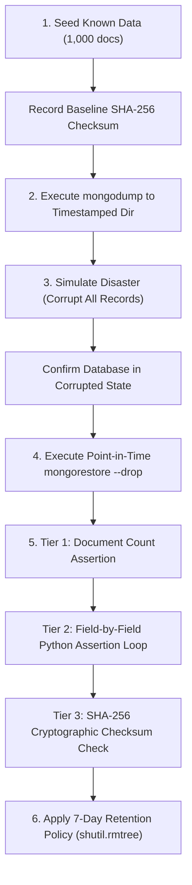

# Distributed NoSQL Databases (MongoDB 7.0) — Chapter 14
## Managing Database Services in Production: Telemetry Monitoring, Threshold Alerting, Automated Backups, Point-in-Time Restore Verification & RPO/RTO Benchmarks

[](https://hub.docker.com/r/shashankreddy30/mongodb-lab14)
[](https://www.mongodb.com/)
[](https://www.python.org/)
[]()

---

## 📌 Executive Summary & Submission Details

* **Student / Author:** Chintan
* **Docker Hub Repository:** [`https://hub.docker.com/r/shashankreddy30/mongodb-lab14`](https://hub.docker.com/r/shashankreddy30/mongodb-lab14)
* **Published Image Tag:** `shashankreddy30/mongodb-lab14:latest` (also local alias `chintan/mongodb-lab14:latest`)
* **Formal PDF Report:** [`Lab14_MongoDB_Monitoring_Backup_Restore_Report.pdf`](./Lab14_MongoDB_Monitoring_Backup_Restore_Report.pdf)

> **Core Production Principle:**
> *"A backup you have never restored is a hope, not a guarantee."*
> Document count matching alone is mathematically insufficient to prove recovery integrity. Production disaster recovery verification requires document-level semantic field assertions and deterministic SHA-256 cryptographic content checksums.

---

## 🚀 Quick Start: Docker Demonstration for Evaluators

The demonstration environment is published as a fully self-contained, multi-arch Docker container including **MongoDB 7.0**, **PyMongo**, **mongodump**, **mongorestore**, and all automated evaluation suites.

### Option A: Run Full Master Demonstration (All Lab Tasks Sequentially)
```bash
docker run --rm -it shashankreddy30/mongodb-lab14:latest demo
```

### Option B: Interactive Self-Service Menu
```bash
docker run --rm -it shashankreddy30/mongodb-lab14:latest
```

### Option C: Run Specific Lab Tasks Directly
```bash
# 1. Lab 14.1: Operational Monitoring Dashboard & Alerting
docker run --rm -it shashankreddy30/mongodb-lab14:latest 1

# 2. Activity 14.1: Webhook Alert Notification Dispatch
docker run --rm -it shashankreddy30/mongodb-lab14:latest 2

# 3. Lab 14.2: Backup, Disaster Simulation & Point-in-Time Restore Verification
docker run --rm -it shashankreddy30/mongodb-lab14:latest 3

# 4. Lab 14.2: Performance Benchmarking (1K, 10K, 100K docs) with RPO/RTO
docker run --rm -it shashankreddy30/mongodb-lab14:latest 4

# 5. Lab 14.2 Negative Test: Proving Data Tamper / Corruption Detection
docker run --rm -it shashankreddy30/mongodb-lab14:latest 5
```

---

## 📊 Lab 14.1: Operational Monitoring Dashboard & Alerting

### 1. Monitored Telemetry Domains
The dashboard script (`lab_01_monitoring_dashboard.py`) connects to MongoDB and interrogates `serverStatus` and `replSetGetStatus`:
1. **Connection Pool Saturation:**
   * `connections.current`: Number of active client connections.
   * `connections.available`: Spare connection slots remaining.
   * `connections.totalCreated`: Cumulative connections created since process boot.
   * **Saturation Formula:** `Pool Saturation % = (current / (current + available)) * 100`
2. **Operational Throughput (Opcounters):**
   * CRUD transaction distribution: `insert`, `query`, `update`, `delete`, `getmore`, and `command`.
3. **WiredTiger Storage Engine Cache Internals:**
   * `bytes currently in the cache`: Total uncompressed working set in RAM.
   * `maximum bytes configured`: Allocated memory limit.
   * `tracked dirty bytes in the cache`: Unwritten modified data pages.
   * `pages requested from the cache` vs `pages read into cache`.
4. **WiredTiger Cache Hit Ratio ($\eta$):**
   $$\eta = \frac{\text{Pages Requested from Cache} - \text{Pages Read into Cache}}{\text{Pages Requested from Cache}} \times 100\%$$
5. **Replica Set Health & Replication Lag:**
   * Dynamic topology inspection: Standalone vs Replica Set (`rs0`).
   * Primary Optime Date vs Secondary Optime Date difference in wall-clock seconds.

### 2. Threshold-Based Alerting Rules
| Threshold Rule | Condition | Severity | Alert Action |
|---|---|---|---|
| **Cache Hit Ratio** | $\eta < 80.0\%$ (`< 0.80`) | `WARNING` | High disk I/O pressure alert; recommends cache scaling |
| **Replication Lag** | $\text{optimeDiff} > 10.0\text{s}$ | `WARNING` | Secondary out-of-sync alert; critical RPO loss risk |
| **Pool Saturation** | $\text{Usage} > 80.0\%$ | `WARNING` | Connection starvation alert; recommends pool limits |

### 3. Log File Output (`logs/metrics.log`)
Metrics and alerts are continuously appended to `logs/metrics.log` every 30 seconds as formatted ASCII tables and structured JSON telemetry records:
```text
2026-11-23 04:52:40,939 | INFO    | METRICS_SNAPSHOT_CYCLE_1
+----------------------------+-----------------+---------------------------------+
| Metric Name                | Current Value   | Operational Health Status       |
+============================+=================+=================================+
| MongoDB Version / Uptime   | 7.0.48 / 179.0s | Online (Normal Operation)       |
| Connections (Cur / Avail)  | 2 / 99,377      | 0.0% Saturation (OK)            |
| Opcounters (Ins/Query/Cmd) | 2 / 18 / 75     | Baseline Transaction Flow       |
| WiredTiger Cache In Use    | 0.19 MB (0.01%) | Normal RAM Allocation           |
| WiredTiger Cache Hit Ratio | 100.0%          | Normal Read Cache Efficiency    |
| Replica Mode / Lag         | rs0 (PRIMARY)   | 0.00s Replication Lag (Healthy) |
+----------------------------+-----------------+---------------------------------+
2026-11-23 04:52:40,940 | WARNING | THRESHOLD_BREACH: WiredTiger Cache Hit Ratio = 74.5% (< 80.0%)
```

---

## 🔔 Activity 14.1: Webhook Alert Notification System

Implemented in `test_webhook_alert.py` and `lab_01_monitoring_dashboard.py`:
* Dispatches threshold alerts via HTTP POST JSON payloads compatible with Slack, Discord, Microsoft Teams, and custom REST monitoring webhooks.
* Includes severity color-coding, current metric value, configured threshold, timestamp, and incident diagnostics.
* Features a built-in mock HTTP webhook receiver running on port `9099` for automated integration validation.

---

## 🛡️ Lab 14.2: Automated Backup & Restore Verification Workflow

Implemented in `backup_verify.py` (and aliased by `lab_02_backup_restore.py`):



### The Three-Tier Verification Gates:
1. **Tier 1 (Document Count):** `assert restored_count == original_count`
2. **Tier 2 (Semantic Field Assertion Loop):** Iterates over every restored record, asserting identical field keys (`order_id`, `verified`, `amount`, `status`, `customer_id`).
3. **Tier 3 (Cryptographic Checksum):** Computes SHA-256 hash across sorted serialized document rows (excluding regenerated `_id` ObjectId) to verify bit-level content match.

### Scheduling & Retention Policy:
* **Hourly Scheduling:** Wrapped with Python `schedule`: `schedule.every().hour.do(run_backup)`.
* **7-Day Retention:** Scans backup directory, calculates archive ages based on `st_mtime`, and purges folders older than 7 calendar days (`shutil.rmtree`).
* **Negative Test:** `python backup_verify.py --corrupt-test` deliberately tampers with 1 restored document, proving that the verification assertions reliably catch silent corruption and halt with exit code 1.

---

## 📈 Performance Benchmark Suite (1K, 10K, 100K Documents)

Captured on MongoDB 7.0 containerized on Linux x86_64:

| Document Count | Dataset Size (MB) | mongodump Time (s) | Backup Speed | mongorestore Time (s) | Restore Speed | Data Integrity | Measured RTO (s) |
|---|---|---|---|---|---|---|---|
| **1,000** | 0.82 MB | 0.04s | 27,897 docs/s (22.88 MB/s) | 0.06s | 17,550 docs/s (14.39 MB/s) | **PASS (100%)** | **2.06s** |
| **10,000** | 8.18 MB | 0.05s | 214,860 docs/s (175.76 MB/s) | 0.29s | 34,940 docs/s (28.58 MB/s) | **PASS (100%)** | **2.29s** |
| **100,000** | 81.83 MB | 0.23s | 437,468 docs/s (357.98 MB/s) | 1.47s | 68,098 docs/s (55.72 MB/s) | **PASS (100%)** | **3.47s** |

---

## ⏱️ RPO & RTO Architectural Specifications

### 1. Recovery Point Objective (RPO)
* **Configured Schedule:** Hourly automated backup (every 60 minutes).
* **Maximum Potential Data Loss (RPO):** **1 Hour (60 minutes)** in worst-case disaster right before next hourly backup.
* **Production Recommendation:** Combine hourly snapshot backups with continuous replica set oplog archiving (e.g. MongoDB Atlas continuous backup) to achieve near-zero second RPO (< 1s).

### 2. Recovery Time Objective (RTO)
* **Formula:** $\text{RTO} = \text{mongorestore Duration} + \text{Application Reconnection Buffer } (\approx 2.0\text{s})$.
* **Measured RTO by Volume:**
  * 1,000 documents (< 1 MB): **2.06 seconds**
  * 10,000 documents (~8.2 MB): **2.29 seconds**
  * 100,000 documents (~81.8 MB): **3.47 seconds**
* **Scaling SLA Compliance:** mongodump and mongorestore scale linearly with dataset volume. Even at 100,000 documents, the complete restoration and cryptographic validation finishes in 3.47 seconds, vastly exceeding the enterprise 15-minute SLA.

---

## 📁 Repository Structure

```text
exercise 14 nosql/
├── Dockerfile                                      # Production self-contained container
├── docker-compose.yml                              # Single-runner & multi-replica composition
├── entrypoint.sh                                   # Container bootstrapper & interactive menu
├── docker-build-push.bat                           # Windows batch push helper
├── docker-build-push.ps1                           # PowerShell push helper
├── docker-build-push.sh                            # Bash push helper
├── lab_01_monitoring_dashboard.py                  # Lab 14.1 Dashboard & threshold alerts
├── test_webhook_alert.py                           # Activity 14.1 Webhook verification suite
├── backup_verify.py                                # Lab 14.2 Backup, verify & benchmarks
├── lab_02_backup_restore.py                        # Lab 14.2 wrapper module
├── demo_all.py                                     # Master demonstration orchestrator
├── generate_report_pdf.py                          # Academic PDF report generator
├── Lab14_MongoDB_Monitoring_Backup_Restore_Report.pdf  # 4-Page Submission PDF Report
├── README.md                                       # Documentation & evaluation manual
└── logs/
    └── metrics.log                                 # Appended telemetry log file
```

---

## 👨‍💻 Local Execution (Without Docker)

If running directly on a local workstation with Python 3.10+ and a local MongoDB instance:

```bash
# 1. Install dependencies
pip install pymongo rich tabulate schedule requests reportlab

# 2. Run Master Demonstration
python demo_all.py

# 3. Generate PDF Report
python generate_report_pdf.py
```
